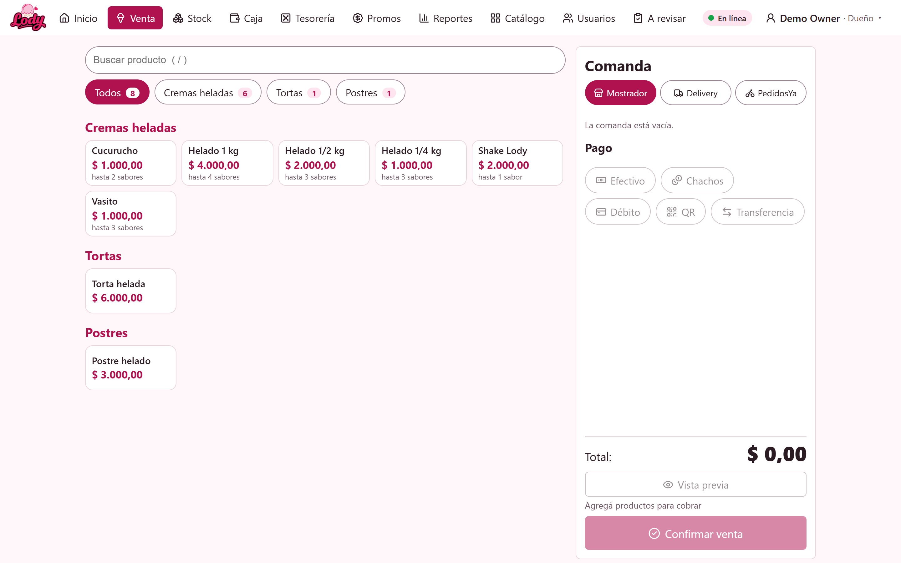
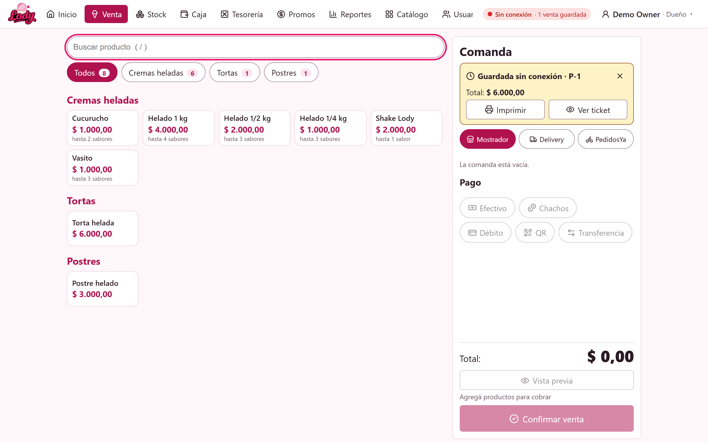
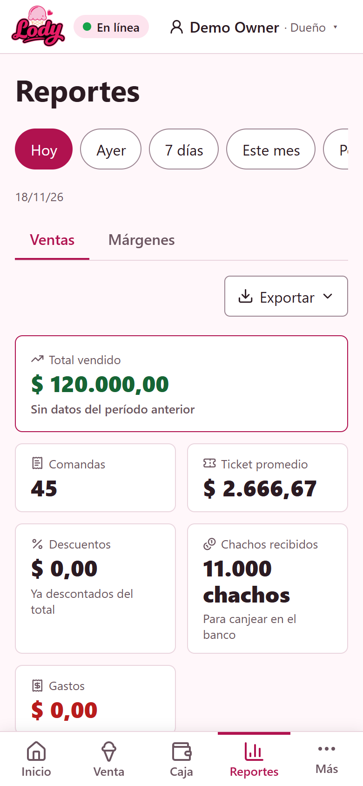

# Lody — Point of Sale & Stock System for an Ice-Cream Shop

> A full-stack TypeScript PWA running **in production** at a real ice-cream shop in La Rioja, Argentina.
> The source code is private (it belongs to a live business); this repository documents the product, the architecture and the technical decisions behind it.

> Screenshots use demo data in an isolated database.



| Sale saved offline (provisional ticket `P-1`) | Reports on a phone |
|---|---|
|  |  |

## The problem

A single-branch ice-cream shop needed to replace paper tickets and a notebook for cash and stock. The constraints were real, not academic:

- **Unstable internet** at the counter: sales cannot stop when the connection drops.
- **Two currencies in the till**: Argentine pesos and *chachos* (La Rioja BOCADE bonds), with change given in either one.
- **Late nights**: the shop closes around 01:00–02:00, so a "business day" does not end at midnight.
- **Three sales channels**: counter, own delivery and PedidosYa, each with different prices and rules.
- **Different roles**: owner, manager and cashier see and do different things.

## What it does

- **Point of sale** with non-fiscal tickets, promotions (2x1, gifts, percent off, bundles) priced by the server.
- **Stock** with suppliers, intake, lots with expiry dates, bulk ice-cream buckets and automatic decrement from sales.
- **Cash shifts** with two cash drawers (pesos and chachos).
- **Treasury** for the owner: an append-only ledger of the whole capital (safe, bank, wallets, what PedidosYa owes).
- **Costs and margins**: every sale snapshots its cost, so profit per product and category is accurate over time.
- **Reports** read from a phone: daily summary, payment methods, flavors, peak hours, supplier CSV export.
- **Users and roles** with cookie sessions, permissions and audit attribution.

## Technical highlights

### Offline-first sales
Creating a sale works without a connection. The PWA shell is precached and the POS data lives in IndexedDB.
If the server does not answer within 4 seconds, the sale goes to a local **outbox** with a provisional ticket number.
A sync engine sends pending sales oldest first, with exponential backoff. **Sales are idempotent by UUID**, so a retry can never create a duplicate. Sales the server rejects (price changed, till closed) are never dropped silently: they go to a review queue.

### Hexagonal architecture
Each business module (`catalog`, `sales`, `promotions`, `stock`, `cash`, `treasury`, `users`, `reports`) is split into:

```
domain/          entities, rules and port interfaces — no framework imports
application/     use cases that depend only on ports
infrastructure/  Drizzle repositories and Fastify routes (adapters)
```

A single composition root wires adapters into use cases. The frontend follows a container/presentational split per feature.

### Shared domain logic
Zod schemas, DTO types and the **promotion pricing engine** live in a shared package used by both API and web, so an offline sale is priced exactly as the server will price it.

### Correctness details
- Money is stored as **integer cents**, never floats.
- A business-day cutoff at 06:00 local time is derived in one single function used everywhere.
- Every table carries a `branch_id`, ready for a second branch.

## Stack

| Layer | Technology |
|---|---|
| API | Node.js, Fastify, TypeScript, Zod |
| Database | PostgreSQL, Drizzle ORM, SQL migrations |
| Web | React, Vite, PWA (service worker + IndexedDB), React Router, TanStack Query |
| Testing | Vitest — 170+ test files across API and web |
| Infrastructure | Render + Neon, Docker Compose for local development, GitHub Actions for automated backups |

## How I built it

I gathered the requirements directly with the shop owner, designed the domain model and the architecture, and developed it with AI coding agents as a tool: I defined what each module had to do, reviewed the output and iterated with the business on real usage.

## Status

In daily production use since **October 25, 2026**. The shop started from scratch on the system: no previous software and no data migration.

## Contact

- LinkedIn: [Nella Agustín Porras](https://www.linkedin.com/in/nella-agustin-porras-b91754219/)
- Email: [neyan.dev@gmail.com](mailto:neyan.dev@gmail.com)
